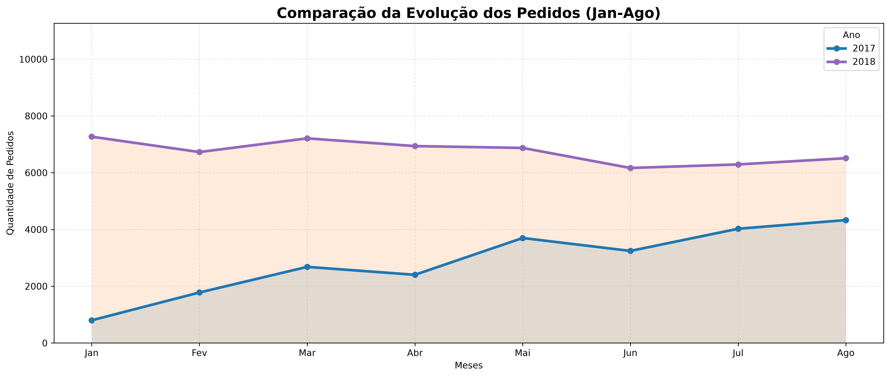
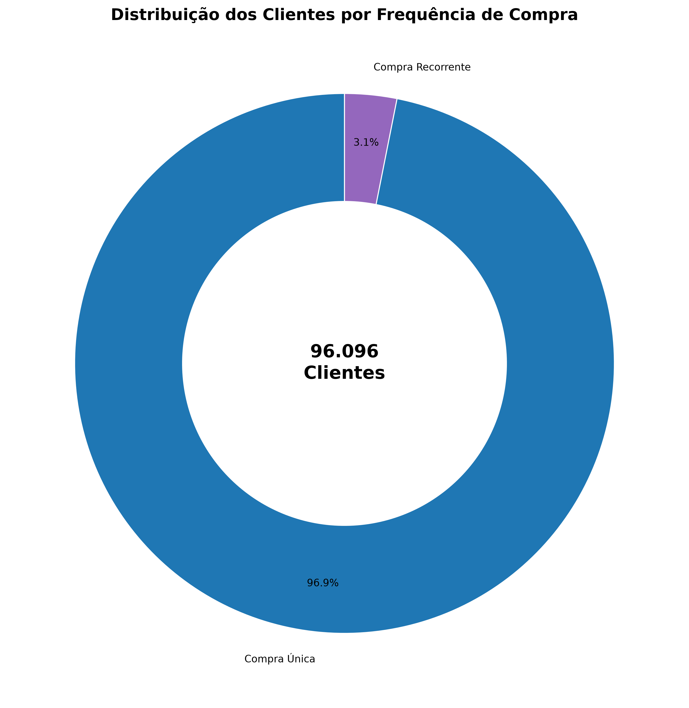
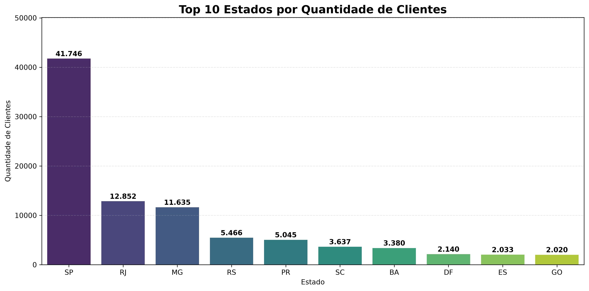

# 📊 Análise Exploratória de Dados \- Olist

## 📌 Objetivo

Este projeto tem como objetivo realizar uma análise exploratória dos dados da Olist para compreender o comportamento da operação logística, a evolução dos pedidos ao longo do tempo e o perfil dos clientes da plataforma.

A análise busca transformar dados brutos em informações relevantes para apoiar decisões de negócio e identificar padrões operacionais.

---

## 🛠️ Tecnologias Utilizadas

- Python
- Pandas
- NumPy
- Matplotlib
- Seaborn
- Jupyter Notebook
- Git
- GitHub

---

## 📂 Dataset

Foi utilizado o **Brazilian E\-Commerce Public Dataset by Olist**, contendo informações sobre:

- Pedidos
- Clientes
- Produtos
- Pagamentos
- Entregas

---

## 🔎 Etapas da Análise

### 1\. Qualidade dos Dados

- Identificação de valores nulos
- Verificação da estrutura das tabelas
- Conversão de colunas de data para formatos adequados

### 2\. Análise Logística

- Tempo médio de entrega
- Distribuição dos prazos de entrega
- Entregas antecipadas e atrasadas
- Comparação entre visualizações para melhor comunicação dos resultados

### 3\. Evolução Temporal

- Volume de pedidos em 2016
- Crescimento da operação em 2017
- Consolidação da demanda em 2018
- Comparação entre os períodos

### 4\. Análise de Clientes

- Frequência de compras
- Compra única versus compra recorrente
- Distribuição geográfica dos clientes
- Principais estados consumidores

---

## 📈 Principais Insights

### Operação Logística

- A maior concentração de entregas ocorreu entre 8 e 14 dias.
- Entregas acima de 60 dias representam uma parcela muito pequena da operação.
- A maior parte dos pedidos foi entregue dentro ou antes do prazo previsto.

### Evolução dos Pedidos

- O volume de pedidos apresentou forte crescimento entre 2016 e 2017.
- Em 2018 a operação atingiu um patamar mais estável de demanda.
- Os dados sugerem uma fase inicial de expansão seguida por consolidação.

### Clientes

- A maior parte dos clientes realizou apenas uma compra.
- O crescimento da plataforma parece ter sido impulsionado principalmente pela aquisição de novos clientes.
- Os clientes estão fortemente concentrados na região Sudeste, especialmente em São Paulo.

---

## 🖼️ Principais Visualizações

### Evolução dos Pedidos (2017 x 2018)

### Distribuição dos Clientes por Frequência de Compra

### Top 10 Estados por Quantidade de Clientes

## 💡 Conclusão

Os resultados indicam que a Olist passou por um período de forte crescimento durante os primeiros anos analisados, sustentado principalmente pela expansão da base de clientes.

A operação apresentou sinais de consolidação em 2018, mantendo um volume consistente de pedidos e uma distribuição geográfica concentrada nos principais centros econômicos do país.

Além dos insights obtidos, o projeto também demonstra a importância da escolha adequada das visualizações para comunicar informações de forma clara e eficiente.

